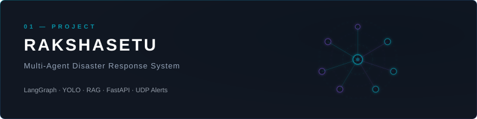
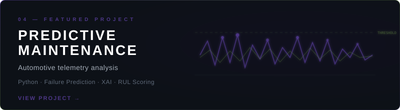

<!--
  MAYUR KIRAN KUMAR S — GitHub Profile
  Software Engineer · Cybersecurity · Applied AI
  github.com/MayurKk777
-->

 

  &nbsp;&nbsp;
  &nbsp;&nbsp;
  &nbsp;&nbsp;
  

 

 

## &nbsp;&nbsp;About

<table>
<tr>
<td>

I build dependable systems for high-stakes problems — from secure authentication and abuse protection to offline-capable disaster response.

My work sits at the intersection of **security engineering**, **applied AI**, and **backend systems**. I care about software that is secure by design, observable in production, and useful when conditions are imperfect.

Currently pursuing **B.E. Computer Science (Cybersecurity)** at **R V College of Engineering**, Bengaluru.

</td>
</tr>
</table>

 

 

## &nbsp;&nbsp;Engineering Domains

<table>
<tr>
<td width="33%" align="center" valign="top">
 

  
<strong>01 — SECURITY ENGINEERING</strong>
  
JWT authentication · RBAC · password security · bot detection · defensive middleware · penetration testing
  
</td>
<td width="33%" align="center" valign="top">
 

  
<strong>02 — APPLIED AI</strong>
  
LangGraph · multi-agent systems · RAG · local LLM inference · computer vision
  
</td>
<td width="33%" align="center" valign="top">
 

  
<strong>03 — BACKEND ENGINEERING</strong>
  
FastAPI · REST APIs · SQLAlchemy · authentication architecture · database design
  
</td>
</tr>
</table>

 

 

## &nbsp;&nbsp;Featured Projects

 

> Agentic multi-agent disaster-response system. Coordinates vision, triage, weather, zone analysis, resource allocation, notification, and supervision through a LangGraph workflow. Uses YOLO for damage detection, RAG for historical context, and a local UDP alert layer for connectivity outages.

 

 

> Blockchain-based carbon-credit verification. Connects ESP32 telemetry to a tamper-evident verification trail using TLS-secured MQTT, anomaly detection, Solidity smart contracts on Polygon Amoy, report hashes, and IPFS CIDs.

 

 

> Password storage and cracking-analysis framework. Compares seven storage strategies, including bcrypt and Argon2id, against dictionary, brute-force, rainbow-table, and hybrid attacks. A live SSE interface exposes cracking performance and a 0–100 security score.

 

 

> Predictive-maintenance system for vehicle telemetry. Explores failure prediction, explainable modeling, and remaining-useful-life scoring to make maintenance decisions more proactive and interpretable.

 

 

## &nbsp;&nbsp;Technical Capabilities

<table>
<tr>
<td><strong>&nbsp;&nbsp;Backend Engineering</strong></td>
<td>Python &nbsp;·&nbsp; FastAPI &nbsp;·&nbsp; REST APIs &nbsp;·&nbsp; SQLAlchemy</td>
</tr>
<tr>
<td><strong>&nbsp;&nbsp;Cybersecurity</strong></td>
<td>Kali Linux &nbsp;·&nbsp; Nmap &nbsp;·&nbsp; Wireshark &nbsp;·&nbsp; Metasploit &nbsp;·&nbsp; Burp Suite &nbsp;·&nbsp; SQLMap</td>
</tr>
<tr>
<td><strong>&nbsp;&nbsp;AI Engineering</strong></td>
<td>LangGraph &nbsp;·&nbsp; Multi-Agent Systems &nbsp;·&nbsp; RAG &nbsp;·&nbsp; Ollama &nbsp;·&nbsp; YOLO</td>
</tr>
<tr>
<td><strong>&nbsp;&nbsp;Core CS</strong></td>
<td>DSA &nbsp;·&nbsp; OOP &nbsp;·&nbsp; Operating Systems &nbsp;·&nbsp; DBMS &nbsp;·&nbsp; Computer Networks</td>
</tr>
</table>

 

 

## &nbsp;&nbsp;Professional Experience

<table>
<tr>
<td width="4" valign="top"></td>
<td>
<strong>Software Engineering Intern</strong> 
Raashi Cognitive Technologies Private Limited &nbsp;·&nbsp; Bengaluru, India 
August 2026 – October 2026
  
<ul>
<li>Designed production RBAC architecture for Admin and Coordinator permissions.</li>
<li>Implemented JWT authentication with token revocation, bcrypt password hashing, and account-lockout protections.</li>
<li>Built bot-detection and IP auto-blocking middleware against automated scraping and abusive traffic.</li>
</ul>
</td>
</tr>
</table>

 

 

## &nbsp;&nbsp;GitHub Analytics

  &nbsp;&nbsp;
  

 

  

 

  

 

 

## &nbsp;&nbsp;Recognition

<table>
<tr>
<td width="60" align="center"><strong>II</strong></td>
<td>
<strong>Runner-Up (2nd Place)</strong> — Ignitrix Hackathon, KLE Technological University 
100+ participating teams · 2026
</td>
</tr>
<tr>
<td width="60" align="center"><strong>R2</strong></td>
<td>
<strong>Shortlisted for Round 2</strong> — EY Techathon 6.0 
2026
</td>
</tr>
</table>

 

 

   
  <a href="mailto:mayurkirankumar@gmail.com">mayurkirankumar@gmail.com</a>
  &nbsp;&nbsp;·&nbsp;&nbsp;
  <a href="https://www.linkedin.com/in/mayur-kiran-kumar-s-730858389/">LinkedIn</a>
  &nbsp;&nbsp;·&nbsp;&nbsp;
  <a href="https://github.com/MayurKk777">GitHub</a>
    

