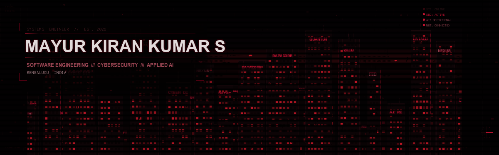

<!--
  ╔══════════════════════════════════════════════════════════════╗
  ║  MAYUR KIRAN KUMAR S — CYBERPUNK CITY TERMINAL              ║
  ║  Cybersecurity · Software Engineering · Applied AI          ║
  ║  github.com/MayurKk777                                      ║
  ║  [ACCESS LEVEL: PUBLIC] [ENCRYPTION: AES-256-GCM]           ║
  ╚══════════════════════════════════════════════════════════════╝
-->

<!-- 0x48455244 — IMMERSIVE CYBERPUNK CITY HERO -->

<div align="center">

<picture>
  <source media="(prefers-color-scheme: dark)" srcset="./assets/hero/cyberpunk-city.gif" />
  <source media="(prefers-color-scheme: light)" srcset="./assets/hero/cyberpunk-city.gif" />
  
</picture>

</div>

<div align="center">
  <br />
  
  <br /><br />
</div>


<br />

<!-- 0x57484F41 — SYSTEM PROFILE -->

<div align="center">

```
╔══════════════════════════════════════════════════════════════════╗
║                    SYSTEM PROFILE  //  whoami                    ║
╚══════════════════════════════════════════════════════════════════╝
```

</div>

<table align="center">
<tr>
<td width="700">

```
root@mayur:~$ whoami
```
```
┌──────────────────────────────────────────────────────────────┐
│                                                              │
│   Name     :  Mayur Kiran Kumar S                            │
│   Role     :  Computer Science Engineer                      │
│   Focus    :  Cybersecurity | Backend Engineering | AI       │
│   Location :  Bengaluru, India                               │
│   Edu      :  B.E. CSE (Cybersecurity), RVCE                 │
│   Status   :  Building secure intelligent systems            │
│                                                              │
└──────────────────────────────────────────────────────────────┘
```
```
root@mayur:~$ cat /var/log/mission.log
```

I build dependable systems for high-stakes problems — from secure authentication
and abuse protection to offline-capable disaster response powered by multi-agent AI.

My work sits at the intersection of **security engineering**, **applied AI**, and
**backend systems**. I care about software that is secure by design, observable in
production, and useful when conditions are imperfect.

```
[LOG] Session verified. Displaying operator profile...
[LOG] Clearance: PUBLIC | Trust Score: 0xFF | Uptime: ∞
```

</td>
</tr>
</table>

<br />


<br />

<!-- 0x534B494C — TECHNICAL ARSENAL -->


<br />

<table align="center">
<tr>
<td width="700">

```
[root@mayur ~/arsenal/languages]$ ls -la
```

&nbsp;
&nbsp;
&nbsp;
&nbsp;
&nbsp;
&nbsp;


---

```
[root@mayur ~/arsenal/backend]$ systemctl status
```

&nbsp;
&nbsp;
&nbsp;
&nbsp;
&nbsp;
&nbsp;


---

```
[root@mayur ~/arsenal/cybersecurity]$ nmap --scan
```

&nbsp;
&nbsp;
&nbsp;
&nbsp;
&nbsp;


---

```
[root@mayur ~/arsenal/ai_ml]$ ollama list
```

&nbsp;
&nbsp;
&nbsp;
&nbsp;
&nbsp;
&nbsp;


---

```
[root@mayur ~/arsenal/devops]$ docker ps
```

&nbsp;
&nbsp;
&nbsp;


```
[OK] All modules loaded. Arsenal operational.
```

</td>
</tr>
</table>

<br />


<br />

<!-- 0x50524F4A — CLASSIFIED PROJECTS -->


<br />

<div align="center">

```
root@mayur:~$ ls -la /projects/classified/ --clearance=public
```

</div>

<br />

<!-- PROJECT 01 -->
<table align="center">
<tr>
<td width="700">

```
╔══════════════════════════════════════════════════════════════════╗
║  PROJECT 01: AUTOMOTIVE PREDICTIVE MAINTENANCE SYSTEM            ║
║  STATUS: ACTIVE  |  CLEARANCE: PUBLIC  |  CLASS: ORIGINAL        ║
╠══════════════════════════════════════════════════════════════════╣
║                                                                  ║
║  BRIEF:  AI-powered fleet management platform that predicts      ║
║          vehicle failures before they happen. Real-time           ║
║          telemetry monitoring, ML-based failure prediction,       ║
║          and automated PDF analytics reporting.                   ║
║                                                                  ║
║  STACK:  Python · FastAPI · PostgreSQL · React · XGBoost          ║
║          Jupyter · Recharts · REST APIs                           ║
║                                                                  ║
║  INTEL:  IoT sensor data → Predictive ML → Maintenance           ║
║          scheduling → Risk categorization → PDF reports           ║
║                                                                  ║
╚══════════════════════════════════════════════════════════════════╝
```

<div align="center">
  <a href="https://github.com/MayurKk777/Automotive-Predictive-Maintenance-System">
    
  </a>&nbsp;
  &nbsp;
  
</div>

</td>
</tr>
</table>

<br />

<!-- PROJECT 02 -->
<table align="center">
<tr>
<td width="700">

```
╔══════════════════════════════════════════════════════════════════╗
║  PROJECT 02: CIPHERGUARD                                         ║
║  STATUS: ACTIVE  |  CLEARANCE: PUBLIC  |  CLASS: CONTRIBUTED     ║
╠══════════════════════════════════════════════════════════════════╣
║                                                                  ║
║  BRIEF:  Cybersecurity research platform and password analysis   ║
║          dashboard. Simulates Dictionary, Brute Force, Rainbow   ║
║          Table, and Hybrid attacks. Calculates security scores   ║
║          and visualizes hashing algorithm resilience.             ║
║                                                                  ║
║  STACK:  Python · FastAPI · React · SQLAlchemy · SQLite           ║
║          bcrypt · Argon2 · Zustand · Recharts                    ║
║                                                                  ║
║  INTEL:  Password hashing → Attack simulation → Security         ║
║          scoring → Breach analysis → Interactive dashboard        ║
║                                                                  ║
╚══════════════════════════════════════════════════════════════════╝
```

<div align="center">
  <a href="https://github.com/MayurKk777/Cipherguard">
    
  </a>&nbsp;
  &nbsp;
  
</div>

</td>
</tr>
</table>

<br />

<!-- PROJECT 03 -->
<table align="center">
<tr>
<td width="700">

```
╔══════════════════════════════════════════════════════════════════╗
║  PROJECT 03: RAKSHA-SETU                                         ║
║  STATUS: ACTIVE  |  CLEARANCE: PUBLIC  |  CLASS: CONTRIBUTED     ║
╠══════════════════════════════════════════════════════════════════╣
║                                                                  ║
║  BRIEF:  AI-driven disaster response system with multi-agent     ║
║          LangGraph workflow. 7 specialized agents handle          ║
║          vision detection (YOLO), weather analysis, zone          ║
║          assessment, resource allocation, and notifications.      ║
║                                                                  ║
║  STACK:  Python · FastAPI · TypeScript · Next.js · LangGraph      ║
║          Ollama · ChromaDB · Supabase · YOLO · spaCy             ║
║                                                                  ║
║  INTEL:  Drone imagery → YOLO detection → Multi-agent AI →       ║
║          RAG memory → Real-time Supabase → UDP broadcast          ║
║                                                                  ║
╚══════════════════════════════════════════════════════════════════╝
```

<div align="center">
  <a href="https://github.com/MayurKk777/Raksha-setu">
    
  </a>&nbsp;
  &nbsp;
  
</div>

</td>
</tr>
</table>

<br />

<!-- PROJECT 04 -->
<table align="center">
<tr>
<td width="700">

```
╔══════════════════════════════════════════════════════════════════╗
║  PROJECT 04: CARBONTRUST BLOCKCHAIN                              ║
║  STATUS: ACTIVE  |  CLEARANCE: PUBLIC  |  CLASS: CONTRIBUTED     ║
╠══════════════════════════════════════════════════════════════════╣
║                                                                  ║
║  BRIEF:  Blockchain-based carbon credit verification platform.   ║
║          IoT sensors collect CO2 data, statistical anomaly       ║
║          detection validates readings, credits minted on          ║
║          Polygon blockchain with IPFS audit trails.               ║
║                                                                  ║
║  STACK:  Kotlin · Python · FastAPI · Solidity · Jetpack Compose   ║
║          MQTT · Polygon · IPFS · Firebase · Arduino              ║
║                                                                  ║
║  INTEL:  ESP32 sensors → MQTT → Anomaly detection → Credit       ║
║          calculation → Blockchain mint → IPFS audit               ║
║                                                                  ║
╚══════════════════════════════════════════════════════════════════╝
```

<div align="center">
  <a href="https://github.com/MayurKk777/CarbonTrust-Blockchain">
    
  </a>&nbsp;
  &nbsp;
  
</div>

</td>
</tr>
</table>

<br />

<div align="center">

```
[root@mayur]$ echo "Total classified projects: 4 | All systems nominal"
```

</div>

<br />


<br />

<!-- 0x5245434F — RECOGNITION -->

<div align="center">

```
╔══════════════════════════════════════════════════════════════════╗
║                      MISSION DEBRIEF                             ║
╚══════════════════════════════════════════════════════════════════╝
```

</div>

<table align="center">
<tr>
<td width="700">

```
root@mayur:~$ cat /var/log/achievements.log

[2026] ██████████░░ RUNNER-UP (2nd Place) — Ignitrix Hackathon
       ├── Host: KLE Technological University
       ├── Scale: 100+ participating teams
       └── Status: VERIFIED ✓

[2026] ████████░░░░ SHORTLISTED (Round 2) — EY Techathon 6.0
       └── Status: VERIFIED ✓
```

</td>
</tr>
</table>

<br />


<br />

<!-- 0x53544154 — SYSTEM ANALYTICS -->


<br />

<!-- GitHub Trophies -->
<div align="center">
  
</div>

<br />

<!-- Stats + Languages -->
<div align="center">
  <a href="https://github.com/MayurKk777?tab=repositories">
    
  </a>&nbsp;&nbsp;
  <a href="https://github.com/MayurKk777?tab=repositories">
    
  </a>
</div>

<br />

<!-- Streak -->
<div align="center">
  
</div>

<br />

<!-- Activity Graph -->
<div align="center">
  
</div>

<br />

<!-- Snake contribution -->
<div align="center">
  <picture>
    <source media="(prefers-color-scheme: dark)" srcset="https://raw.githubusercontent.com/MayurKk777/MayurKk777/output/github-snake-dark.svg" />
    <source media="(prefers-color-scheme: light)" srcset="https://raw.githubusercontent.com/MayurKk777/MayurKk777/output/github-snake.svg" />
    
  </picture>
</div>

<br />

<div align="center">

```
root@mayur:~$ echo "Analytics feed nominal. All telemetry operational."
> Analytics feed nominal. All telemetry operational.
```

</div>

<br />


<br />

<!-- 0x434F4E4E — SECURE CHANNEL -->



<br />

<table align="center">
<tr>
<td width="700">

```
root@mayur:~$ establish_connection --protocols

Scanning available channels...

  > [GITHUB]     ::  github.com/MayurKk777
  > [LINKEDIN]   ::  linkedin.com/in/mayur-kiran-kumar-s-730858389
  > [EMAIL]      ::  mayurkirankumar@gmail.com

  Status: ALL CHANNELS ENCRYPTED (TLS 1.3)
  Protocol: SSH-2.0-OpenSSH_9.6
```

</td>
</tr>
</table>

<br />

<div align="center">
  <a href="https://github.com/MayurKk777">
    
  </a>&nbsp;&nbsp;
  <a href="https://www.linkedin.com/in/mayur-kiran-kumar-s-730858389/">
    
  </a>&nbsp;&nbsp;
  <a href="mailto:mayurkirankumar@gmail.com">
    
  </a>&nbsp;&nbsp;
  
</div>

<br /><br />


<br />

<!-- 0x464F4F54 — FOOTER -->


<div align="center">
  <br />
  
  <br /><br />
</div>


<!--
  ╔══════════════════════════════════════════════════════════════╗
  ║  EOF — root@mayur:~$ exit                                    ║
  ║  Connection closed by remote host.                           ║
  ║  0x4D415955524B4B373737                                      ║
  ╚══════════════════════════════════════════════════════════════╝
-->

