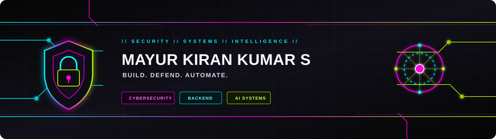

<!--
  Profile README for github.com/MayurKk777
  Drop this file into the root of the MayurKk777/MayurKk777 repository.
-->



<div align="center">
  

  <br />
  <br />

  <a href="https://www.linkedin.com/in/mayur-kiran-kumar-s-730858389/">
    
  </a>
  <a href="mailto:mayurkirankumar@gmail.com">
    
  </a>
  <a href="https://github.com/MayurKk777">
    
  </a>
  
</div>

<div align="center">
  
</div>

<div align="center">
  
  
  
</div>

## // 01 - SYSTEMS PROFILE

```yaml
name: Mayur Kiran Kumar S
role: Computer Science (Cybersecurity) student | Software Engineering Intern
location: Bengaluru, India
education: B.E. Computer Science (Cybersecurity), R V College of Engineering
focus:
  - Secure backend systems
  - Agentic AI for real-world response
  - Security engineering and offensive-security research
```

I build dependable systems for high-stakes problems - from secure authentication and abuse protection to offline-capable disaster response. My north star: software should be secure by design, observable in production, and useful when conditions are imperfect.

## // 02 - THREE-PILLAR STACK

<table>
  <tr>
    <td width="50%" valign="top">
      <h3>🛡️ Security engineering</h3>
      <p>JWT authentication, role-based access control, password security, bot detection, and defensive middleware for production-facing services.</p>
    </td>
    <td width="50%" valign="top">
      <h3>🧠 Applied AI</h3>
      <p>Multi-agent workflows, local LLM inference, RAG, and computer vision systems designed to remain useful when connectivity is unreliable.</p>
    </td>
  </tr>
</table>

<div align="center">
  <sub><code>[ DEFEND ]</code> &nbsp; → &nbsp; <code>[ BUILD ]</code> &nbsp; → &nbsp; <code>[ AUTOMATE ]</code></sub>
</div>

## // 03 - FEATURED DEPLOYMENTS

<table>
  <tr>
    <td width="50%" valign="top">
      <h3><a href="https://github.com/MayurKk777/Raksha-setu">🚨 RakshaSetu</a></h3>
      <p><strong>Agentic multi-agent disaster-response system.</strong></p>
      <p>Coordinates vision, triage, weather, zone analysis, resource allocation, notification, and supervision through a LangGraph workflow. Uses YOLO for damage detection, RAG for historical context, and a local UDP alert layer for connectivity outages.</p>
      
      
      
    </td>
    <td width="50%" valign="top">
      <h3><a href="https://github.com/MayurKk777/CarbonTrust-Blockchain">🌿 CarbonTrust</a></h3>
      <p><strong>Blockchain-based carbon-credit verification.</strong></p>
      <p>Connects ESP32 telemetry to a tamper-evident verification trail using TLS-secured MQTT, anomaly detection, Solidity smart contracts on Polygon Amoy, report hashes, and IPFS CIDs.</p>
      
      
      
    </td>
  </tr>
  <tr>
    <td width="50%" valign="top">
      <h3><a href="https://github.com/MayurKk777/Cipherguard">🔐 CipherGuard</a></h3>
      <p><strong>Password storage and cracking-analysis framework.</strong></p>
      <p>Compares seven storage strategies, including bcrypt and Argon2id, against dictionary, brute-force, rainbow-table, and hybrid attacks. A live SSE interface exposes cracking performance and a 0-100 security score.</p>
      
      
    </td>
    <td width="50%" valign="top">
      <h3><a href="https://github.com/MayurKk777/Automotive-Predictive-Maintenance-System">🚗 Automotive Predictive Maintenance</a></h3>
      <p><strong>Predictive-maintenance system for vehicle telemetry.</strong></p>
      <p>Explores failure prediction, explainable modeling, and remaining-useful-life scoring to make maintenance decisions more proactive and interpretable.</p>
      
      
    </td>
  </tr>
</table>

## // 04 - TECHNOLOGY MATRIX

<div align="center">
  <a href="https://skillicons.dev">
    
  </a>
</div>

<br />

<table>
  <tr>
    <td><strong>01 / Backend</strong></td>
    <td>FastAPI · REST APIs · SQLAlchemy · database design · JWT authentication</td>
  </tr>
  <tr>
    <td><strong>02 / Security</strong></td>
    <td>Kali Linux · Nmap · Wireshark · Metasploit · Burp Suite · SQLMap · penetration testing</td>
  </tr>
  <tr>
    <td><strong>03 / Intelligence</strong></td>
    <td>LangGraph · multi-agent systems · RAG · Ollama · YOLO</td>
  </tr>
  <tr>
    <td><strong>Computer science</strong></td>
    <td>DSA, OOP, operating systems, DBMS, computer networks</td>
  </tr>
</table>

## // 05 - FIELD EXPERIENCE

**Software Engineering Intern** · Raashi Cognitive Technologies Private Limited<br>
`Aug 2026 - Oct 2026` · Bengaluru, India

- Designed a production role-based access-control system for Admin and Coordinator permissions.
- Implemented JWT authentication with token revocation, bcrypt password hashing, and account-lockout protections.
- Built bot-detection and IP auto-blocking middleware against automated scraping and abusive traffic.

## // 06 - LIVE TELEMETRY

<div align="center">
  <a href="https://github.com/MayurKk777?tab=repositories">
    
  </a>
  <a href="https://github.com/MayurKk777?tab=repositories">
    
  </a>
</div>

<div align="center">
  
</div>

<div align="center">
  
</div>

## // 07 - RECOGNITION

- 🥈 **Runner-Up (2nd Place)** - Ignitrix Hackathon, KLE Technological University; 100+ participating teams (2026)
- ✨ **Shortlisted for Round 2** - EY Techathon 6.0 (2026)

<div align="center">
  <sub>“Build systems that keep working when the stakes are highest.”</sub>
  <br />
  <br />
  <a href="mailto:mayurkirankumar@gmail.com">Let’s build something that matters →</a>
</div>


