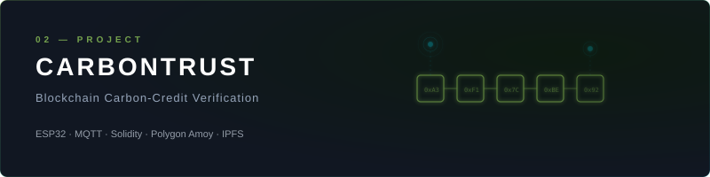
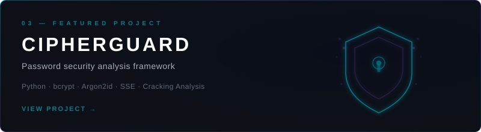

<!--
  MAYUR KIRAN KUMAR S — GitHub Profile
  Software Engineer · Cybersecurity · Applied AI
  github.com/MayurKk777
-->



<div align="center">
  <br />
  
  <br /><br />

  <a href="https://www.linkedin.com/in/mayur-kiran-kumar-s-730858389/">
    
  </a>&nbsp;
  <a href="mailto:mayurkirankumar@gmail.com">
    
  </a>&nbsp;
  <a href="https://github.com/MayurKk777">
    
  </a>&nbsp;
  
</div>

<br />


<br />

<!-- ═══════════════════════════════════════════════════════════ -->
<!-- ABOUT SECTION -->
<!-- ═══════════════════════════════════════════════════════════ -->


<div align="center">
  
</div>

<table align="center">
<tr>
<td width="700">

```
╭──────────────────────────────────────────────────╮
│  name     : Mayur Kiran Kumar S                  │
│  role     : Software Engineer | Security | AI    │
│  location : Bengaluru, India                     │
│  edu      : B.E. CSE (Cybersecurity), RVCE       │
│  status   : Building dependable systems          │
╰──────────────────────────────────────────────────╯
```

I build dependable systems for high-stakes problems — from secure authentication and abuse protection to offline-capable disaster response.

My work sits at the intersection of **security engineering**, **applied AI**, and **backend systems**. I care about software that is secure by design, observable in production, and useful when conditions are imperfect.

</td>
</tr>
</table>

<br />


<br />

<!-- ═══════════════════════════════════════════════════════════ -->
<!-- ENGINEERING DOMAINS -->
<!-- ═══════════════════════════════════════════════════════════ -->

<div align="center">
  
</div>

<table align="center">
<tr>
<td width="33%" align="center" valign="top">

<br />


### `01` SECURITY

<sub>

JWT authentication · RBAC · password security · bot detection · defensive middleware · penetration testing

</sub>

<br />

</td>
<td width="33%" align="center" valign="top">

<br />


### `02` APPLIED AI

<sub>

LangGraph · multi-agent systems · RAG · local LLM inference · computer vision

</sub>

<br />

</td>
<td width="33%" align="center" valign="top">

<br />


### `03` BACKEND

<sub>

FastAPI · REST APIs · SQLAlchemy · authentication architecture · database design

</sub>

<br />

</td>
</tr>
</table>

<div align="center">
  <br />
  <code>[ DEFEND ]</code> &nbsp; ⟶ &nbsp; <code>[ BUILD ]</code> &nbsp; ⟶ &nbsp; <code>[ AUTOMATE ]</code>
  <br /><br />
</div>


<br />

<!-- ═══════════════════════════════════════════════════════════ -->
<!-- FEATURED PROJECTS -->
<!-- ═══════════════════════════════════════════════════════════ -->

<div align="center">
  
</div>

<br />

<a href="https://github.com/MayurKk777/Raksha-setu">
  
</a>

<br />

<details>
<summary>&nbsp;&nbsp;⟐ &nbsp; <b>Expand — RakshaSetu Architecture</b></summary>
<br />

> Agentic multi-agent disaster-response system. Coordinates **vision**, **triage**, **weather analysis**, **zone analysis**, **resource allocation**, **notification**, and **supervision** through a LangGraph workflow. Uses YOLO for damage detection, RAG for historical context, and a local UDP alert layer for connectivity outages.

| Component | Technology |
|---|---|
| Orchestration | LangGraph Multi-Agent |
| Vision | YOLO Object Detection |
| Knowledge | RAG Pipeline |
| Backend | FastAPI |
| Offline | UDP Alert System |

</details>

<br /><br />

<a href="https://github.com/MayurKk777/CarbonTrust-Blockchain">
  
</a>

<br />

<details>
<summary>&nbsp;&nbsp;⟐ &nbsp; <b>Expand — CarbonTrust Architecture</b></summary>
<br />

> Blockchain-based carbon-credit verification. Connects **ESP32 telemetry** to a tamper-evident verification trail using TLS-secured MQTT, anomaly detection, Solidity smart contracts on Polygon Amoy, report hashes, and IPFS CIDs.

| Component | Technology |
|---|---|
| IoT | ESP32 Sensors |
| Transport | TLS-secured MQTT |
| Blockchain | Solidity / Polygon Amoy |
| Storage | IPFS CIDs |
| Detection | Anomaly Analysis |

</details>

<br /><br />

<a href="https://github.com/MayurKk777/Cipherguard">
  
</a>

<br />

<details>
<summary>&nbsp;&nbsp;⟐ &nbsp; <b>Expand — CipherGuard Architecture</b></summary>
<br />

> Password storage and cracking-analysis framework. Compares **seven storage strategies**, including bcrypt and Argon2id, against dictionary, brute-force, rainbow-table, and hybrid attacks. A live SSE interface exposes cracking performance and a 0–100 security score.

| Attack Type | Coverage |
|---|---|
| Dictionary | ✓ |
| Brute-Force | ✓ |
| Rainbow Table | ✓ |
| Hybrid | ✓ |
| Algorithms | bcrypt, Argon2id, +5 more |

</details>

<br /><br />

<a href="https://github.com/MayurKk777/Automotive-Predictive-Maintenance-System">
  
</a>

<br />

<details>
<summary>&nbsp;&nbsp;⟐ &nbsp; <b>Expand — Predictive Maintenance Details</b></summary>
<br />

> Predictive-maintenance system for vehicle telemetry. Explores **failure prediction**, **explainable modeling**, and **remaining-useful-life scoring** to make maintenance decisions more proactive and interpretable.

| Capability | Description |
|---|---|
| Prediction | Component failure forecasting |
| Explainability | XAI model interpretation |
| RUL | Remaining Useful Life scoring |
| Data | Vehicle telemetry streams |

</details>

<br />


<br />

<!-- ═══════════════════════════════════════════════════════════ -->
<!-- TECH STACK -->
<!-- ═══════════════════════════════════════════════════════════ -->

<div align="center">
  
</div>

<br />

<div align="center">
  <a href="https://skillicons.dev">
    
  </a>
</div>

<br />

<table align="center">
<tr>
<td align="center" width="150"><strong>Backend</strong></td>
<td>

`Python` `FastAPI` `REST APIs` `SQLAlchemy` `JWT` `Database Design`

</td>
</tr>
<tr>
<td align="center"><strong>Security</strong></td>
<td>

`Kali Linux` `Nmap` `Wireshark` `Metasploit` `Burp Suite` `SQLMap`

</td>
</tr>
<tr>
<td align="center"><strong>AI / ML</strong></td>
<td>

`LangGraph` `Multi-Agent Systems` `RAG` `Ollama` `YOLO`

</td>
</tr>
<tr>
<td align="center"><strong>Core CS</strong></td>
<td>

`DSA` `OOP` `Operating Systems` `DBMS` `Computer Networks`

</td>
</tr>
</table>

<br />


<br />

<!-- ═══════════════════════════════════════════════════════════ -->
<!-- EXPERIENCE -->
<!-- ═══════════════════════════════════════════════════════════ -->

<div align="center">
  
</div>

<br />

<table align="center">
<tr>
<td width="8" valign="top">

</td>
<td>
<h3>Software Engineering Intern</h3>
<strong>Raashi Cognitive Technologies Private Limited</strong><br />
<sub>📍 Bengaluru, India &nbsp; · &nbsp; 🗓️ August 2026 – October 2026</sub>
<br /><br />

- ⚡ Designed production **RBAC architecture** for Admin and Coordinator permissions
- 🔐 Implemented **JWT authentication** with token revocation, bcrypt password hashing, and account-lockout protections
- 🛡️ Built **bot-detection** and **IP auto-blocking middleware** against automated scraping and abusive traffic

</td>
</tr>
</table>

<br />


<br />

<!-- ═══════════════════════════════════════════════════════════ -->
<!-- GITHUB ANALYTICS -->
<!-- ═══════════════════════════════════════════════════════════ -->

<div align="center">
  
</div>

<br />

<!-- Trophies -->
<div align="center">
  
</div>

<br />

<!-- Stats + Languages side by side -->
<div align="center">
  <a href="https://github.com/MayurKk777?tab=repositories">
    
  </a>&nbsp;&nbsp;
  <a href="https://github.com/MayurKk777?tab=repositories">
    
  </a>
</div>

<br />

<!-- Streak -->
<div align="center">
  
</div>

<br />

<!-- Activity Graph -->
<div align="center">
  
</div>

<br />

<!-- Snake contribution graph -->
<div align="center">
  <picture>
    <source media="(prefers-color-scheme: dark)" srcset="https://raw.githubusercontent.com/MayurKk777/MayurKk777/output/github-snake-dark.svg" />
    <source media="(prefers-color-scheme: light)" srcset="https://raw.githubusercontent.com/MayurKk777/MayurKk777/output/github-snake.svg" />
    
  </picture>
</div>

<br />


<br />

<!-- ═══════════════════════════════════════════════════════════ -->
<!-- RECOGNITION -->
<!-- ═══════════════════════════════════════════════════════════ -->

<div align="center">
  
</div>

<br />

<div align="center">
<table>
<tr>
<td align="center" width="80">

</td>
<td>
<strong>Runner-Up (2nd Place)</strong> — Ignitrix Hackathon<br />
<sub>KLE Technological University · 100+ participating teams · 2026</sub>
</td>
</tr>
<tr>
<td align="center" width="80">

</td>
<td>
<strong>Shortlisted for Round 2</strong> — EY Techathon 6.0<br />
<sub>2026</sub>
</td>
</tr>
</table>
</div>

<br />


<br />

<!-- ═══════════════════════════════════════════════════════════ -->
<!-- FOOTER -->
<!-- ═══════════════════════════════════════════════════════════ -->


<div align="center">
  <br />
  <a href="mailto:mayurkirankumar@gmail.com">
    
  </a>&nbsp;
  <a href="https://www.linkedin.com/in/mayur-kiran-kumar-s-730858389/">
    
  </a>&nbsp;
  <a href="https://github.com/MayurKk777">
    
  </a>
  <br /><br />
</div>


